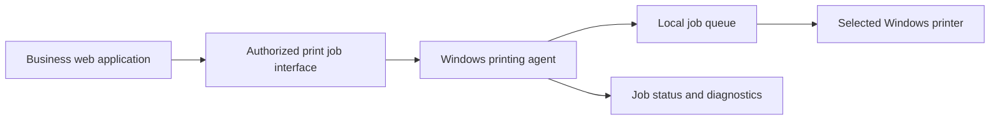

# Valorium Impressor
### Windows Print Automation Agent — Engineering Showcase

**Python · Windows · SQLite · Print Queues · Web Systems Integration**

*A technical portfolio case study. Proprietary source code is not included.*

[Architecture](docs/architecture.md) · [Printing Workflow](docs/printing-workflow.md) · [Engineering Challenges](docs/technical-challenges.md) · [Security](docs/security.md)

## Overview

Valorium Impressor is a Windows-based printing agent developed as part of the Valorium software ecosystem. The project aims to bridge web-based business workflows and locally installed printers, reducing manual printing steps while preserving operational control.

This public repository documents the engineering approach, system boundaries, and design considerations. It is **not** the production repository, a downloadable application, or a claim of production readiness.

## Problem and approach

Web applications often cannot reliably operate a user's local printers without a trusted local component. Valorium Impressor addresses this challenge through a Windows agent designed to receive authorized print jobs, process them through a controlled queue, and dispatch them to a user-selected printer.

The project also considers reprints, failure handling, persistence, and eventual support for printer routing by operational area.

## Technology stack

| Area | Technology / concept |
| --- | --- |
| Desktop agent | Python on Windows |
| Local state and queue experiments | SQLite |
| Printer integration | Windows-installed printers |
| System integration | Web application ↔ local agent |
| Reliability concerns | Job states, retries, idempotency, recovery |
| Validation | Automated tests and controlled failure scenarios |

## Architecture at a glance

*Conceptual architecture; exact protocols, implementation details, and deployment topology are intentionally omitted.*

## Engineering focus

- Selecting among printers installed on Windows and preserving user configuration.
- Separating business transactions from printing operations.
- Processing new jobs and user-requested reprints without duplicating the original order.
- Handling interruptions, retries, and ambiguous printer outcomes safely.
- Testing queue persistence and recovery scenarios.
- Designing future routing to printers by department or workflow.

## Implementation status

This showcase describes both work in progress and architectural goals. Individual capabilities must be validated against the current private build before being described as released or production-ready. See [technical challenges](docs/technical-challenges.md).

## Visual documentation

Sanitized application screenshots and diagrams may be added to `assets/` after privacy and security review. No production screenshots are included in this initial release.

## My role

**Guilherme Langkammer** — Founder & Software Developer, Valorium Sistemas. Project planning, Python development, integration design, troubleshooting, and testing.

## Contact

- [GitHub](https://github.com/Guilherme-Langkammer)
- [LinkedIn](https://www.linkedin.com/in/guilherme-de-paula-langkammer-1a64b0344/)
- Email: guilhermelangkammer008@gmail.com

## Notice

This repository contains **documentation only**. Valorium product code, internal configurations, customer information, credentials, and deployment details remain private. No license to use proprietary software is granted by this showcase.
