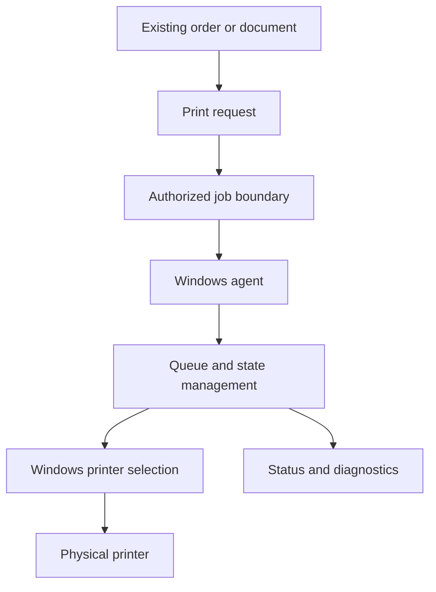

# Architecture — Conceptual Overview

## Objective

Connect business operations in web applications to printers installed on a Windows workstation through a local printing agent.

## Logical components

1. **Business application:** initiates an authorized print request for an existing business record.
2. **Job interface:** separates business requests from local printer operations.
3. **Windows agent:** retrieves or receives authorized jobs and manages local processing.
4. **Queue and state:** records processing state and supports controlled recovery experiments.
5. **Printer adapter:** targets a printer installed in Windows according to local configuration.
6. **Diagnostics:** supports investigation of failures without exposing customer data.

## Design principles

- Business records and print jobs have separate lifecycles.
- A reprint must not create a new order or modify financial state.
- Retry policies must account for uncertain physical printer outcomes.
- Printer configuration should remain explicit and user-controlled.
- Internal endpoints, authentication design, and deployment details are intentionally not published.

**Status note:** This is a conceptual model, not a verified as-built production diagram.
